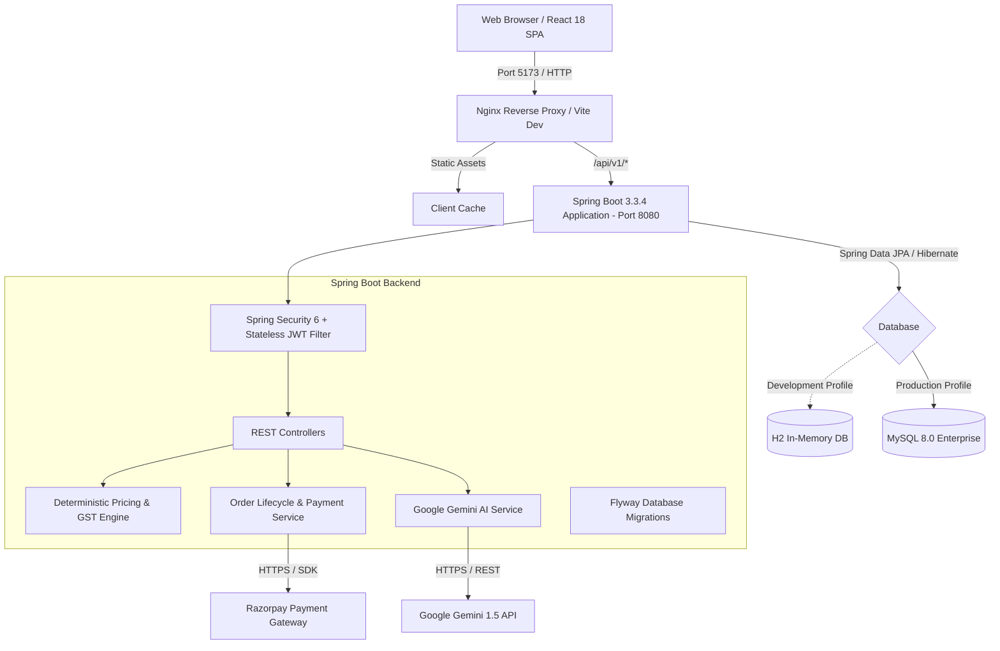

# SAKTHI GARMENTS — AI-Powered 3D T-Shirt Customization & Garment Marketplace

[](https://spring.io/projects/spring-boot)
[](https://www.oracle.com/java/)
[](https://react.dev/)
[](https://threejs.org/)
[](https://vitejs.dev/)
[](https://tailwindcss.com/)
[](LICENSE)

> **Flagship Partner**: **SAKTHI GARMENTS**  
> **Location**: Town Hall Road, Tiruppur — 641601, Tamil Nadu, India  
> **Specialty**: 100% Bio-Washed Combed Cotton (180–240 GSM), High-Definition DTG Printing, Physical Fabric Sample Swatches starting at **₹69**, Sizes S to XXXL.

---

## 🌟 Executive Overview

**SAKTHI GARMENTS** is an enterprise-grade full-stack web platform bridging the textile manufacturing capital of India—**Tiruppur**—directly with businesses, independent fashion labels, and end consumers. 

The platform merges real-time 3D procedural garment rendering, Google Gemini Generative AI, server-side deterministic pricing, Razorpay payment processing, and a multi-tenant B2B/B2C marketplace.

### Core Capabilities

1. **Procedural 3D T-Shirt Studio**:
   - Custom-engineered procedural 3D t-shirt mesh (torso, raglan/regular sleeves, rib-knit collar, folded hem) built in **React Three Fiber** and **Three.js**.
   - Procedural canvas-based micro-weave bump map providing realistic cotton knit fabric texture.
   - Dynamic canvas texture projection supporting multiple layered decals (vector text, raster logos, Gemini AI art) with position, rotation, and scaling controls.
   - 3-point cinematic studio lighting (key, fill, back rim lights) with multi-angle camera switching (Front, Back, Left, Right, Collar Close-up, Fabric Macro).
   - High-resolution production print-pack export (composite render + transparent 300 DPI print-ready decal coordinates).

2. **Cinematic Hero Landing Page**:
   - 6-scene scroll-driven 3D experience powered by **GSAP ScrollTrigger** and **Framer Motion**.
   - Interactive camera choreography transitioning from macroscopic fabric weave to 360° spin, exploded customization layers, mill craftsmanship, and instant design actions.

3. **Tiruppur Textile Marketplace**:
   - Direct manufacturer directory with radius-based proximity search using browser geolocation and Tamil Nadu pincodes.
   - Fabric swatch evaluation pack orders starting at **₹69** (enabling tactile evaluation of softness, GSM thickness, and dye durability before committing to bulk runs).
   - Bulk Request-for-Quote (RFQ) engine with tiered volume discounting (up to 30% off for 1,000+ units).

4. **Google Gemini Generative AI**:
   - AI Slogan & Typography Generator (curated for streetwear, minimalism, corporate branding, and Tamil cultural motifs).
   - Prompt-to-Print Artwork Synthesis generating high-resolution vectors/graphics directly loaded into the 3D studio.
   - Automated Design Critique & Printability Analyzer evaluating color contrast, fabric bleed risk, and recommended printing techniques (DTG vs. Screen Printing).

5. **Server-Side Pricing & Tax Engine**:
   - Deterministic pricing engine preventing client-side price tampering.
   - Precise itemization: Base garment cost, GSM fabric premium, front decal complexity surcharge, back print surcharge, tiered quantity discounts, 5% Indian Garment GST, and free shipping over ₹999.

6. **Order Fulfillment & Logistics Tracking**:
   - End-to-end order lifecycle: `PENDING_PAYMENT` ➔ `CONFIRMED` ➔ `PRINTING_QUEUED` ➔ `IN_PRODUCTION` ➔ `QUALITY_AUDIT` ➔ `DISPATCHED` ➔ `DELIVERED`.
   - Live visual tracking stepper with simulated India Post / Blue Dart courier AWB integration.

---

## 🏛️ System Architecture



---

## 📂 Monorepo Repository Structure

```
d:/SG MASTER/
├── backend/                             # Java 21 / Spring Boot 3.3.4 Application
│   ├── src/
│   │   ├── main/
│   │   │   ├── java/com/sakthigarments/
│   │   │   │   ├── config/              # Security, JWT filter, OpenAPI Swagger config
│   │   │   │   ├── controller/          # 12 REST API Controllers (/api/v1/...)
│   │   │   │   ├── dto/                 # Auth, Pricing, Order, AI, Customizer DTOs
│   │   │   │   ├── exception/           # Global exception handler & custom exceptions
│   │   │   │   ├── model/               # JPA entities (User, Company, Product, Order, etc.)
│   │   │   │   ├── repository/          # 9 Spring Data JPA repositories
│   │   │   │   ├── service/             # Business logic (Pricing, AI, Payment, Auth)
│   │   │   │   └── SakthiGarmentsApplication.java
│   │   │   └── resources/
│   │   │       ├── application.yml      # Base Spring Boot configuration
│   │   │       ├── application-dev.yml  # H2 Zero-Dependency Dev Profile
│   │   │       ├── application-mysql.yml# MySQL Production Profile
│   │   │       └── db/migration/        # Flyway SQL migrations (V1 schema, V2 seed data)
│   │   └── test/java/com/sakthigarments/# Automated unit & lifecycle test suites
│   ├── Dockerfile                       # Multi-stage Eclipse Temurin 21 Dockerfile
│   └── pom.xml                          # Maven build specification
│
├── frontend/                            # React 18 / Vite / TypeScript Application
│   ├── src/
│   │   ├── components/                  # Navbar, Footer, CustomCursor, ProtectedRoute
│   │   ├── context/                     # AuthContext, CartContext, CustomizerContext
│   │   ├── pages/                       # 16 Full feature pages (Customizer, Marketplace, etc.)
│   │   ├── three/                       # R3F Canvas, Procedural T-Shirt, Studio Lighting
│   │   ├── types/                       # TypeScript interfaces and domain models
│   │   ├── App.tsx                      # Client router and route definitions
│   │   └── main.tsx                     # React DOM entrypoint
│   ├── Dockerfile                       # Multi-stage Node 20 & Nginx Alpine Dockerfile
│   ├── nginx.conf                       # Production Nginx reverse proxy configuration
│   ├── package.json                     # Frontend dependencies and scripts
│   └── vite.config.ts                   # Vite configuration with API reverse proxy
│
├── docs/                                # Technical Documentation
│   ├── architecture.md                  # Deep-dive system architecture & design patterns
│   ├── database_schema.md               # Complete ER diagram and data dictionary
│   ├── api_documentation.md             # Exhaustive REST API endpoint catalog
│   ├── local_setup_guide.md             # Step-by-step local developer setup guide
│   ├── gemini_setup_guide.md            # Google Gemini AI configuration & prompt engineering
│   ├── payment_setup_guide.md           # Razorpay webhook and payment flow documentation
│   └── deployment_guide.md              # Docker, Cloud, and CI/CD deployment instructions
│
├── docker-compose.yml                   # Production orchestration (MySQL 8, Backend, Frontend)
├── .env.example                         # Master environment variables template
└── README.md                            # Monorepo documentation
```

---

## ⚡ Quick Start Guide (Local Development)

### Prerequisites

- **Java Development Kit (JDK)**: Java 21 or Java 25 installed.
- **Apache Maven**: Version 3.8+ (A standalone portable build is available at `d:\tools\apache-maven-3.9.6\bin\mvn.cmd`).
- **Node.js**: Node 18+ or 20+ and npm 10+.

### Step 1: Run the Unified Full-Stack Website (Single URL Mode)

The entire full-stack platform (React SPA Frontend + Spring Boot Backend + Persistent Database) runs through a **single localhost URL**:

```powershell
cd "d:\SG MASTER"

# Option A: One command via root package.json
npm start

# Option B: Run Spring Boot directly from backend
cd "d:\SG MASTER\backend"
mvn spring-boot:run
```

- 🌐 **Unified Website (Full React App + 3D Studio)**: [`http://localhost:8080/`](http://localhost:8080/)
- 👕 **3D T-Shirt Customizer**: [`http://localhost:8080/customizer`](http://localhost:8080/customizer)
- 🏬 **Textile Marketplace**: [`http://localhost:8080/marketplace`](http://localhost:8080/marketplace)
- 📖 **Interactive Swagger API Docs**: [`http://localhost:8080/swagger-ui.html`](http://localhost:8080/swagger-ui.html)
- 💾 **H2 Database Console**: [`http://localhost:8080/h2-console`](http://localhost:8080/h2-console)  
  *(JDBC URL: `jdbc:h2:file:./data/sakthidb`, User: `sa`, Password: empty)*

---

### Step 2: (Optional) Frontend Hot-Reload Development

If you are developing frontend components with instant Vite HMR hot reloading:

```powershell
cd "d:\SG MASTER\frontend"
npm run dev
```

- **Frontend Dev URL**: [`http://localhost:5173`](http://localhost:5173) *(Proxies all `/api/*` calls directly to backend at port 8080)*

---

### Step 3: Run with Docker Compose (Full Stack with MySQL 8)

To spin up the entire production stack (MySQL 8, Spring Boot Backend, and Nginx-powered React Frontend) in isolated Docker containers:

```powershell
cd "d:\SG MASTER"

# Copy environment variables
cp .env.example .env

# Build and start containers
docker-compose up --build -d
```

| Service | Container Name | Host Port | Internal Port | URL |
| :--- | :--- | :--- | :--- | :--- |
| **Frontend** | `sakthi_frontend` | `5173` | `80` | `http://localhost:5173` |
| **Backend** | `sakthi_backend` | `8080` | `8080` | `http://localhost:8080` |
| **MySQL Database**| `sakthi_mysql` | `3306` | `3306` | `localhost:3306` |

---

## 🔑 Default Seeded Credentials

The application comes pre-loaded with three user accounts for immediate role-based testing:

| Role | Email Address | Password | Permissions & Dashboard |
| :--- | :--- | :--- | :--- |
| **Platform Super Admin** | `superadmin@sakthigarments.in` | `SakthiAdmin@2026` | Mill approvals, platform analytics, global order management (`/admin`) |
| **Tiruppur Mill Partner** | `admin@sakthigarments.in` | `SakthiAdmin@2026` | SAKTHI GARMENTS catalog, production queue, bulk quotes (`/company/dashboard`) |
| **Registered Customer** | `customer@sakthigarments.in` | `SakthiAdmin@2026` | Saved 3D customizer projects, live order tracking, re-ordering (`/dashboard`) |

> You can also register a new account on the frontend registration page (`/signup`) at any time.

---

## 🛠️ REST API Reference Highlights

All REST endpoints reside under the `/api/v1` namespace.

| Domain | Method | Endpoint | Description | Auth Required |
| :--- | :--- | :--- | :--- | :--- |
| **Auth** | `POST` | `/api/v1/auth/register` | Register new customer or company user | No |
| **Auth** | `POST` | `/api/v1/auth/login` | Authenticate and obtain JWT token | No |
| **Auth** | `GET` | `/api/v1/auth/me` | Fetch currently logged-in user profile | Yes (Bearer) |
| **Customizer**| `POST` | `/api/v1/customizer/projects` | Save 3D customizer project & layer specs | Yes (Bearer) |
| **Customizer**| `GET` | `/api/v1/customizer/templates` | Fetch pre-built high-converting graphics | No |
| **AI** | `POST` | `/api/v1/ai/generate-slogan` | Generate typographic slogans with Gemini | No |
| **AI** | `POST` | `/api/v1/ai/generate-artwork` | Synthesize prompt-driven t-shirt artwork | No |
| **AI** | `POST` | `/api/v1/ai/design-critique` | Automated AI review of printability & contrast | No |
| **Pricing** | `POST` | `/api/v1/pricing/calculate` | Compute deterministic itemized breakdown | No |
| **Checkout** | `POST` | `/api/v1/checkout/create-order` | Initialize order and create Razorpay order ID | Yes (Bearer) |
| **Checkout** | `POST` | `/api/v1/checkout/verify-payment`| Verify HMAC SHA256 payment signature | Yes (Bearer) |
| **Orders** | `GET` | `/api/v1/orders/track/{trackingNo}`| Track live stages & courier shipment status | No |
| **Samples** | `POST` | `/api/v1/samples` | Order physical fabric sample swatches (₹69) | Yes (Bearer) |
| **Marketplace**| `GET` | `/api/v1/companies/nearby` | Find Tiruppur mills by GPS lat/lng radius | No |

*For complete request/response schemas, refer to [docs/api_documentation.md](file:///d:/SG%20MASTER/docs/api_documentation.md) or launch Swagger at `http://localhost:8080/swagger-ui.html`.*

---

## 🧪 Automated Testing

Both unit tests and end-to-end service lifecycle tests are included in the backend:

```powershell
cd "d:\SG MASTER\backend"
mvn test
```

**Test Suite Coverage**:
- `PricingServiceTest`: Validates sample swatch calculations (₹69), tiered bulk discounts (10% at 50 units, 20% at 100 units, 30% at 500 units), front & back print surcharges, and 5% GST calculation.
- `AuthServiceTest`: Validates registration, duplicate email rejection, BCrypt hashing, and JWT token issuance.
- `OrderLifecycleTest`: Validates complete lifecycle transition from order creation to payment verification, inventory deduction, and tracking code assignment.

---

## 📖 In-Depth Documentation Index

For comprehensive technical guides, consult the dedicated manuals in the `/docs` directory:

1. [**System Architecture**](file:///d:/SG%20MASTER/docs/architecture.md): Monorepo structure, 3D WebGL rendering pipeline, state management, and security architecture.
2. [**Database Schema & Migrations**](file:///d:/SG%20MASTER/docs/database_schema.md): Entity relationship diagrams, schema definitions, indexes, and Flyway migration strategy.
3. [**API Documentation**](file:///d:/SG%20MASTER/docs/api_documentation.md): Comprehensive endpoint specifications with JSON request/response payloads.
4. [**Local Setup Guide**](file:///d:/SG%20MASTER/docs/local_setup_guide.md): Detailed installation steps for Windows, macOS, and Linux.
5. [**Google Gemini Setup Guide**](file:///d:/SG%20MASTER/docs/gemini_setup_guide.md): API key provisioning, fallback synthesis logic, and customizer prompt design.
6. [**Payment Gateway Guide**](file:///d:/SG%20MASTER/docs/payment_setup_guide.md): Razorpay test keys, webhook handling, mock test verification, and reconciliation.
7. [**Production Deployment Guide**](file:///d:/SG%20MASTER/docs/deployment_guide.md): Production builds, Docker Compose, Nginx tuning, and cloud deployment.

---

## 📜 License & Acknowledgements

Developed for **SAKTHI GARMENTS**, Town Hall Road, Tiruppur — 641601, Tamil Nadu.  
Licensed under the [MIT License](LICENSE).
