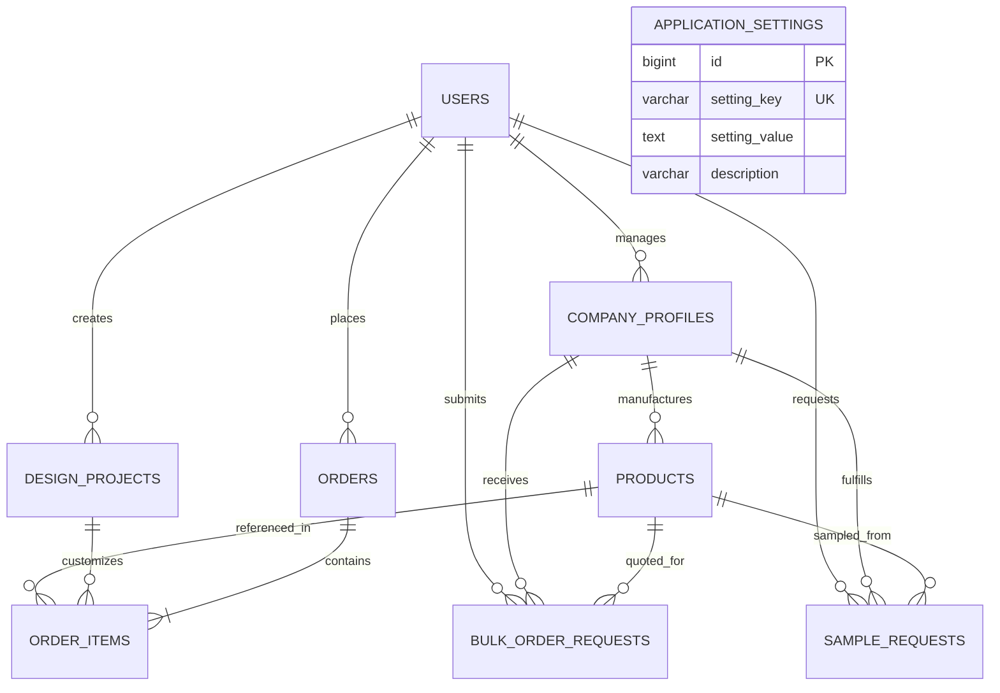

# SAKTHI GARMENTS — Database Schema & Data Dictionary

## 1. Entity Relationship (ER) Diagram



---

## 2. Flyway Migration Strategy

Database versioning is managed via **Flyway**:
- **`V1__init_schema.sql`**: Baseline relational schema with core tables, primary & foreign keys, indexing, and UTF-8 encoding.
- **`V2__seed_initial_data.sql`**: Seeds default platform settings, the flagship partner mill (**SAKTHI GARMENTS, Town Hall Road, Tiruppur — 641601**), partner mills, initial products (including the **₹69** evaluation swatch pack and **₹299** custom t-shirt), and pre-configured test users with BCrypt hashes.
- **`V3__comprehensive_normalized_schema.sql`**: Fully normalized enterprise schema expanding to 30+ tables, including `roles`, `user_roles`, `addresses`, `customer_profiles`, `company_documents`, `product_variants`, `product_images`, `inventory`, `pricing_rules`, `design_layers`, `design_templates`, `carts`, `cart_items`, `order_status_history`, `payments`, `refunds`, `shipments`, `quotations`, `notifications`, `support_tickets`, `support_messages`, `reviews`, and `audit_logs`.

---

## 2.1 MongoDB to MySQL 8 Migration Pipeline

The project includes an automated data migration pipeline (`MongoToMySqlMigrationService` and `MongoDocumentParser`):
- **Source Mode**: Reads legacy MongoDB collections from raw JSON export files (`classpath:data/mongodb_export/*.json`) or live MongoDB instances.
- **Normalizing Unstructured Data**: Converts nested BSON/JSON arrays and subdocuments into distinct relational entities with foreign keys (e.g. converting nested order item arrays into `order_items` rows, nested addresses into `addresses` rows).
- **ID Preservation & Mapping**: Resolves legacy MongoDB 24-character hex `ObjectId` strings into MySQL `BIGINT` auto-incrementing primary keys using in-memory concurrent mapping caches.
- **Integrity Validation & Reporting**: Verifies foreign-key integrity post-migration and logs migration metrics into `audit_logs`. An interactive REST endpoint is exposed at `/api/v1/admin/migration/execute` and `/api/v1/admin/migration/report`.

---

## 3. Data Dictionary

### 3.1 `users`
Stores authenticated platform identities across all three permission roles: `CUSTOMER`, `COMPANY`, and `ADMIN`.

| Column | Type | Constraints | Description |
| :--- | :--- | :--- | :--- |
| `id` | `BIGINT` | `PRIMARY KEY, AUTO_INCREMENT` | Unique user identifier |
| `email` | `VARCHAR(180)` | `NOT NULL, UNIQUE` | Normalized login email address |
| `password_hash` | `VARCHAR(255)` | `NOT NULL` | BCrypt salted password hash |
| `full_name` | `VARCHAR(120)` | `NOT NULL` | User's full contact name |
| `phone_number` | `VARCHAR(25)` | `NULL` | Contact telephone / WhatsApp number |
| `role` | `VARCHAR(20)` | `NOT NULL, DEFAULT 'CUSTOMER'` | Role: `ADMIN`, `COMPANY`, `CUSTOMER` |
| `is_active` | `BOOLEAN` | `NOT NULL, DEFAULT TRUE` | Account active flag |
| `company_id` | `BIGINT` | `NULL, FK -> company_profiles(id)`| Associated mill (for `COMPANY` role) |
| `created_at` | `TIMESTAMP` | `DEFAULT CURRENT_TIMESTAMP` | Account registration timestamp |
| `updated_at` | `TIMESTAMP` | `DEFAULT CURRENT_TIMESTAMP ON UPDATE`| Last profile modification timestamp |

---

### 3.2 `company_profiles`
Stores textile mill partners located in Tiruppur and surrounding garment manufacturing clusters.

| Column | Type | Constraints | Description |
| :--- | :--- | :--- | :--- |
| `id` | `BIGINT` | `PRIMARY KEY, AUTO_INCREMENT` | Unique company profile identifier |
| `company_name` | `VARCHAR(150)` | `NOT NULL` | Registered business / mill name |
| `contact_person`| `VARCHAR(100)` | `NOT NULL` | Primary representative / owner name |
| `email` | `VARCHAR(180)` | `NOT NULL` | Business correspondence email |
| `phone_number` | `VARCHAR(25)` | `NOT NULL` | Mill office contact number |
| `address` | `TEXT` | `NOT NULL` | Street address (e.g., Town Hall Road) |
| `city` | `VARCHAR(80)` | `NOT NULL, DEFAULT 'Tiruppur'` | City of operation |
| `state` | `VARCHAR(80)` | `NOT NULL, DEFAULT 'Tamil Nadu'`| State |
| `pincode` | `VARCHAR(10)` | `NOT NULL` | Indian Postal PIN (e.g., 641601) |
| `latitude` | `DECIMAL(10,7)`| `NULL` | GPS latitude for radius proximity search |
| `longitude` | `DECIMAL(10,7)`| `NULL` | GPS longitude for radius proximity search |
| `approval_status`| `VARCHAR(20)`| `NOT NULL, DEFAULT 'PENDING'` | Status: `PENDING`, `APPROVED`, `REJECTED` |
| `min_order_quantity`| `INT` | `NOT NULL, DEFAULT 1` | Minimum standard order quantity |
| `customization_available`| `BOOLEAN` | `DEFAULT TRUE` | Supports 3D digital DTG customization |
| `bulk_order_support`| `BOOLEAN`| `DEFAULT TRUE` | Accepts industrial bulk production quotes |
| `sample_available`| `BOOLEAN` | `DEFAULT TRUE` | Offers physical fabric swatch packs |
| `sample_price` | `DECIMAL(10,2)`| `DEFAULT 69.00` | Price for fabric sample swatch pack (₹) |
| `estimated_production_days`| `INT` | `DEFAULT 3` | Average turnaround time in business days |
| `published_price_range`| `VARCHAR(50)`| `NULL` | Price range display (e.g., '₹249 - ₹499') |
| `description` | `TEXT` | `NULL` | Mill profile, machinery & certifications |
| `created_at` | `TIMESTAMP` | `DEFAULT CURRENT_TIMESTAMP` | Profile onboarding timestamp |
| `updated_at` | `TIMESTAMP` | `DEFAULT CURRENT_TIMESTAMP ON UPDATE`| Profile update timestamp |

---

### 3.3 `products`
Garment catalog items, blank apparel, and fabric swatch packs.

| Column | Type | Constraints | Description |
| :--- | :--- | :--- | :--- |
| `id` | `BIGINT` | `PRIMARY KEY, AUTO_INCREMENT` | Unique product identifier |
| `company_id` | `BIGINT` | `NOT NULL, FK -> company_profiles(id)` | Manufacturing partner mill |
| `name` | `VARCHAR(200)` | `NOT NULL` | Product title |
| `sku` | `VARCHAR(60)` | `NOT NULL, UNIQUE` | Stock keeping unit identifier |
| `description` | `TEXT` | `NULL` | Detailed technical product copy |
| `garment_type` | `VARCHAR(60)` | `NOT NULL, DEFAULT 'T-Shirt'` | Garment style (T-Shirt, Polo, Swatch) |
| `fabric` | `VARCHAR(100)`| `NOT NULL` | Fiber composition (e.g., 100% Cotton) |
| `fabric_gsm` | `INT` | `NOT NULL, DEFAULT 180` | Fabric density in grams per square meter |
| `fit` | `VARCHAR(50)` | `DEFAULT 'Regular Fit'` | Cut / silhouette type |
| `sleeve_type` | `VARCHAR(50)` | `DEFAULT 'Half Sleeve'` | Sleeve style |
| `base_price` | `DECIMAL(10,2)`| `NOT NULL` | Base price in INR before customization |
| `min_order_quantity`| `INT` | `DEFAULT 1` | Minimum purchasing quantity |
| `stock_quantity`| `INT` | `DEFAULT 500` | Current available inventory |
| `is_customizable`| `BOOLEAN` | `DEFAULT TRUE` | Accessible inside 3D studio editor |
| `sample_available`| `BOOLEAN` | `DEFAULT TRUE` | Available for swatch evaluation |
| `sample_price` | `DECIMAL(10,2)`| `DEFAULT 69.00` | Sample unit price in INR |
| `is_published` | `BOOLEAN` | `DEFAULT TRUE` | Visibility in marketplace |
| `created_at` | `TIMESTAMP` | `DEFAULT CURRENT_TIMESTAMP` | Product creation timestamp |

---

### 3.4 `design_projects`
Persisted 3D customizer sessions, layer hierarchies, and printable assets.

| Column | Type | Constraints | Description |
| :--- | :--- | :--- | :--- |
| `id` | `BIGINT` | `PRIMARY KEY, AUTO_INCREMENT` | Unique project identifier |
| `user_id` | `BIGINT` | `NOT NULL, FK -> users(id)` | Creator / owner of the design |
| `product_id` | `BIGINT` | `NOT NULL, FK -> products(id)` | Base product customized |
| `project_name` | `VARCHAR(150)`| `NOT NULL` | User-assigned project title |
| `garment_color`| `VARCHAR(20)` | `NOT NULL, DEFAULT '#FFFFFF'` | Hex color code applied to 3D mesh |
| `fabric_type` | `VARCHAR(60)` | `DEFAULT 'Combed Cotton'` | Fabric texture choice |
| `fabric_gsm` | `INT` | `DEFAULT 220` | Selected fabric weight |
| `design_data_json`| `LONGTEXT` | `NOT NULL` | Serialized layer hierarchy JSON |
| `thumbnail_url`| `LONGTEXT` | `NULL` | Base64 / URL of rendered 3D preview |
| `print_export_url`| `LONGTEXT`| `NULL` | 300 DPI transparent production asset |
| `created_at` | `TIMESTAMP` | `DEFAULT CURRENT_TIMESTAMP` | Project timestamp |

---

### 3.5 `orders`
Master purchase orders with transactional and logistics metadata.

| Column | Type | Constraints | Description |
| :--- | :--- | :--- | :--- |
| `id` | `BIGINT` | `PRIMARY KEY, AUTO_INCREMENT` | Unique order identifier |
| `order_number` | `VARCHAR(60)` | `NOT NULL, UNIQUE` | Business reference (e.g., `SG-2026-9481`) |
| `user_id` | `BIGINT` | `NOT NULL, FK -> users(id)` | Ordering customer account |
| `subtotal` | `DECIMAL(10,2)`| `NOT NULL` | Pre-tax order sum in INR |
| `tax_amount` | `DECIMAL(10,2)`| `NOT NULL` | 5% Indian Garment GST in INR |
| `shipping_amount`| `DECIMAL(10,2)`| `NOT NULL` | Logistics delivery charge |
| `discount_amount`| `DECIMAL(10,2)`| `DEFAULT 0.00` | Applied bulk volume discount |
| `total_amount` | `DECIMAL(10,2)`| `NOT NULL` | Final billed amount in INR |
| `status` | `VARCHAR(30)` | `NOT NULL` | `PENDING_PAYMENT`, `CONFIRMED`, `IN_PRODUCTION`, `DISPATCHED`, `DELIVERED`, `CANCELLED` |
| `payment_status`| `VARCHAR(30)` | `NOT NULL` | `PENDING`, `COMPLETED`, `FAILED` |
| `payment_method`| `VARCHAR(30)` | `DEFAULT 'RAZORPAY'` | Payment method identifier |
| `razorpay_order_id`| `VARCHAR(100)`| `NULL` | Razorpay order reference |
| `razorpay_payment_id`| `VARCHAR(100)`| `NULL` | Razorpay payment reference |
| `shipping_address`| `TEXT` | `NOT NULL` | Full delivery address |
| `city` | `VARCHAR(80)` | `NOT NULL` | Shipping destination city |
| `state` | `VARCHAR(80)` | `NOT NULL` | Shipping destination state |
| `pincode` | `VARCHAR(10)` | `NOT NULL` | Destination postal PIN |
| `tracking_number`| `VARCHAR(60)`| `NULL, UNIQUE` | Logistics AWB tracking code |
| `carrier_name` | `VARCHAR(60)` | `DEFAULT 'Blue Dart / India Post'` | Courier partner name |
| `created_at` | `TIMESTAMP` | `DEFAULT CURRENT_TIMESTAMP` | Order timestamp |

---

### 3.6 `order_items`
Itemized line items linked to an order, recording sizing breakdown and custom design snapshots.

| Column | Type | Constraints | Description |
| :--- | :--- | :--- | :--- |
| `id` | `BIGINT` | `PRIMARY KEY, AUTO_INCREMENT` | Line item identifier |
| `order_id` | `BIGINT` | `NOT NULL, FK -> orders(id)` | Parent order |
| `product_id` | `BIGINT` | `NOT NULL, FK -> products(id)` | Purchased product |
| `design_project_id`| `BIGINT` | `NULL, FK -> design_projects(id)` | Associated custom design project |
| `size` | `VARCHAR(10)` | `NOT NULL` | Selected size: `S`, `M`, `L`, `XL`, `XXL`, `XXXL` |
| `color` | `VARCHAR(30)` | `NOT NULL` | Colorway identifier or Hex |
| `quantity` | `INT` | `NOT NULL` | Line item quantity |
| `unit_price` | `DECIMAL(10,2)`| `NOT NULL` | Final calculated unit price |
| `total_price` | `DECIMAL(10,2)`| `NOT NULL` | Extended line price (`quantity * unit_price`) |

---

### 3.7 `bulk_order_requests`
B2B Request-for-Quote (RFQ) pipeline for volume manufacturing.

| Column | Type | Constraints | Description |
| :--- | :--- | :--- | :--- |
| `id` | `BIGINT` | `PRIMARY KEY, AUTO_INCREMENT` | Unique RFQ identifier |
| `user_id` | `BIGINT` | `NOT NULL, FK -> users(id)` | Submitting corporate buyer |
| `company_id` | `BIGINT` | `NOT NULL, FK -> company_profiles(id)` | Target Tiruppur mill partner |
| `product_id` | `BIGINT` | `NULL, FK -> products(id)` | Requested garment style |
| `target_quantity`| `INT` | `NOT NULL` | Requested production volume |
| `target_price_per_unit`| `DECIMAL(10,2)`| `NULL` | Buyer's target price |
| `quoted_price_per_unit`| `DECIMAL(10,2)`| `NULL` | Mill's formal counter-quote |
| `status` | `VARCHAR(30)` | `DEFAULT 'SUBMITTED'` | `SUBMITTED`, `UNDER_REVIEW`, `QUOTED`, `ACCEPTED`, `REJECTED` |
| `specifications_notes`| `TEXT` | `NULL` | Fabric specs, GSM, delivery deadline |

---

### 3.8 `sample_requests`
Fast-track physical fabric swatch orders starting at ₹69.

| Column | Type | Constraints | Description |
| :--- | :--- | :--- | :--- |
| `id` | `BIGINT` | `PRIMARY KEY, AUTO_INCREMENT` | Sample request identifier |
| `user_id` | `BIGINT` | `NOT NULL, FK -> users(id)` | Requesting user |
| `company_id` | `BIGINT` | `NOT NULL, FK -> company_profiles(id)` | Mill providing the swatches |
| `product_id` | `BIGINT` | `NULL, FK -> products(id)` | Associated garment style |
| `sample_price` | `DECIMAL(10,2)`| `DEFAULT 69.00` | Swatch price in INR |
| `shipping_address`| `TEXT` | `NOT NULL` | Courier delivery address |
| `status` | `VARCHAR(30)` | `DEFAULT 'REQUESTED'` | `REQUESTED`, `DISPATCHED`, `DELIVERED` |
| `tracking_number`| `VARCHAR(60)`| `NULL` | Sample shipment tracking AWB |

---

### 3.9 `application_settings`
Dynamic platform configuration parameters.

| Column | Type | Constraints | Description |
| :--- | :--- | :--- | :--- |
| `id` | `BIGINT` | `PRIMARY KEY, AUTO_INCREMENT` | Setting ID |
| `setting_key` | `VARCHAR(80)` | `NOT NULL, UNIQUE` | Unique configuration key |
| `setting_value` | `TEXT` | `NOT NULL` | Configuration value |
| `description` | `VARCHAR(255)`| `NULL` | Operational explanation |

---

## 4. Database Indexing Scheme

The following high-cardinality indexes are created in `V1__init_schema.sql` to optimize query latency under high transactional load:

```sql
CREATE INDEX idx_users_email ON users(email);
CREATE INDEX idx_users_role ON users(role);
CREATE INDEX idx_companies_city_pincode ON company_profiles(city, pincode);
CREATE INDEX idx_companies_status ON company_profiles(approval_status);
CREATE INDEX idx_products_company ON products(company_id);
CREATE INDEX idx_products_sku ON products(sku);
CREATE INDEX idx_orders_user ON orders(user_id);
CREATE INDEX idx_orders_status ON orders(status);
CREATE INDEX idx_orders_tracking ON orders(tracking_number);
CREATE INDEX idx_order_items_order ON order_items(order_id);
CREATE INDEX idx_bulk_orders_company ON bulk_order_requests(company_id);
CREATE INDEX idx_sample_requests_user ON sample_requests(user_id);
```
