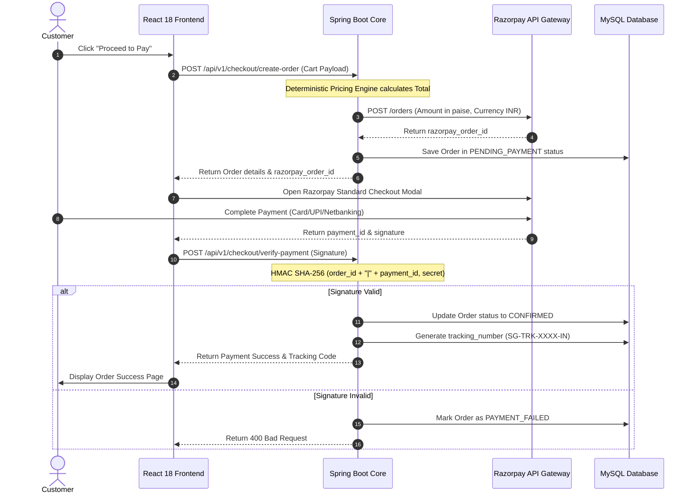

# SAKTHI GARMENTS — Payment Gateway Integration & Setup Guide

## 1. Overview of Payment Processing Architecture

SAKTHI GARMENTS integrates **Razorpay**—India's leading payment gateway—to process debit/credit cards, UPI (Google Pay, PhonePe, Paytm), Netbanking, and corporate wallets with end-to-end cryptographic verification.



---

## 2. Obtaining Razorpay Test Keys

1. Sign up for a Razorpay account at [https://dashboard.razorpay.com/](https://dashboard.razorpay.com/).
2. Toggle the dashboard to **"Test Mode"** using the switcher at the top right.
3. Navigate to **Account & Settings** ➔ **API Keys**.
4. Click **"Generate Test Key"**.
5. Save the **Key ID** (`rzp_test_...`) and **Key Secret**.

---

## 3. Configuration

### Backend Configuration

In `backend/.env` or system environment:

```ini
RAZORPAY_KEY_ID=rzp_test_sakthi_dev
RAZORPAY_KEY_SECRET=your_razorpay_secret_here
```

### Frontend Configuration

In `frontend/.env`:

```ini
VITE_RAZORPAY_KEY_ID=rzp_test_sakthi_dev
```

---

## 4. Razorpay Sandbox Test Credentials

When testing the checkout flow in test mode, use the following credentials in the Razorpay payment modal:

### Test Cards (Domestic Indian Cards)

| Card Brand | Card Number | Expiry | CVV | OTP |
| :--- | :--- | :--- | :--- | :--- |
| **Visa / Mastercard** | `4111 1111 1111 1111` | Any future date (e.g., `12/28`) | `123` | `123456` |
| **RuPay (Domestic)** | `5081 5900 0000 0001` | Any future date | `123` | `123456` |

### Test UPI Handles

- `success@razorpay` (Simulates instant UPI approval)
- `failure@razorpay` (Simulates rejected UPI authorization)

---

## 5. Cryptographic Signature Verification Details

To prevent man-in-the-middle tampering, `PaymentService.java` executes HMAC SHA-256 verification:

```java
String data = razorpayOrderId + "|" + razorpayPaymentId;
Mac sha256_HMAC = Mac.getInstance("HmacSHA256");
SecretKeySpec secret_key = new SecretKeySpec(keySecret.getBytes(StandardCharsets.UTF_8), "HmacSHA256");
sha256_HMAC.init(secret_key);
byte[] hash = sha256_HMAC.doFinal(data.getBytes(StandardCharsets.UTF_8));
String calculatedSignature = Hex.encodeHexString(hash);

boolean isValid = calculatedSignature.equals(submittedSignature);
```

### Zero-Dependency Developer Mode (Mock Fallback)
For zero-dependency local testing without active internet or third-party accounts, the application includes a pre-configured developer fallback:
- If `key-id` starts with `rzp_test_sakthi_dev`, any test signature or simulated payment ID automatically verifies successfully.
- This allows complete end-to-end checkout validation without needing an internet connection.
